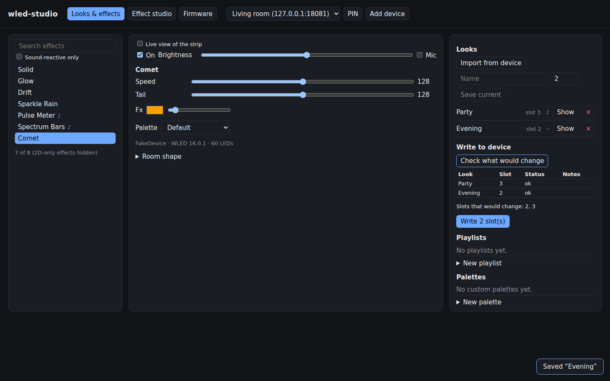
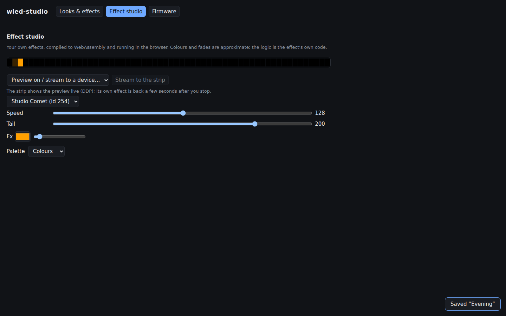

# wled-studio

A local web app for [WLED](https://kno.wled.ge) controllers: edit looks (presets), layers, every
effect setting, playlists and palettes on a proper screen, keep them in a library by name, and
write them back safely. Later: write your own effects, preview them in the browser and on the
strip, and build verified firmware with them ([wled-studio-builder](https://github.com/Laffs2k5/wled-studio-builder)).

**Status: early work in progress.** See [docs/getting-started.md](docs/getting-started.md) to try it,
and [docs/status.md](docs/status.md) for what's done and next.





*Screenshots against the built-in fake device (`docker compose --profile demo up`).*

## What works so far

- Add devices; read what each offers: effects with **their own controls** (from WLED's effect
  metadata), palettes, LED count.
- Live control with a validated subset of WLED's state API, and a **live view** of what the strip
  shows, drawn in the **room's shape** once you describe it (walls in LED order).
- Import presets into a **library keyed by name**, capture the live state as a look, apply a look
  live. **Playlists** of looks and **custom palettes** (a gradient editor) live in the library too.
- **Push** looks back as one `presets.json`:
  - backup, then a drift check (refuses if someone else changed the presets);
  - upload with the settings PIN, then read back and verify;
  - effects are resolved by name, and each look gets a change-check status.
- **Firmware with your effects:** gate builds through
  [wled-studio-builder](https://github.com/Laffs2k5/wled-studio-builder). The vendor's stock image is
  rebuilt and checked first, then only your code may differ. Flashing isn't built yet.
- **Effect studio:**
  - write or edit effect usermods in the browser (new ones start from a template with a fixed
    effect id);
  - compile them to WebAssembly and watch them on a strip, with their own controls, and **stream
    the preview to the real strip** (DDP) before any firmware is built;
  - then build them into firmware through the gate.
- A fake WLED device for tests and a demo mode.

## Run it

```bash
docker compose up                    # http://localhost:8080
docker compose --profile demo up     # also starts a fake WLED device at demo-device:8081
WLEDSTUDIO_BUILDER_URL=http://builder:8090 docker compose --profile firmware up
                                     # also the firmware builder; your effects go in ./effects
```

Your own effects live in `./effects` (one usermod folder each; git-ignored). The Effect studio
edits them in the browser; the app runs as uid 10001, so give it the folder:
`sudo chown -R 10001:10001 effects`.

By default it listens on `127.0.0.1` only. See [docs/security.md](docs/security.md) before
exposing it on your LAN.

## Develop

```bash
cd backend && python -m venv .venv && .venv/bin/pip install -e '.[dev]' && .venv/bin/pytest
cd frontend && npm ci && npm test && npm run build
```

## Licence

EUPL-1.2 ([LICENSE](LICENSE)). The app talks to WLED over its HTTP API and contains no WLED code;
its tests use a fake device with made-up effects.
