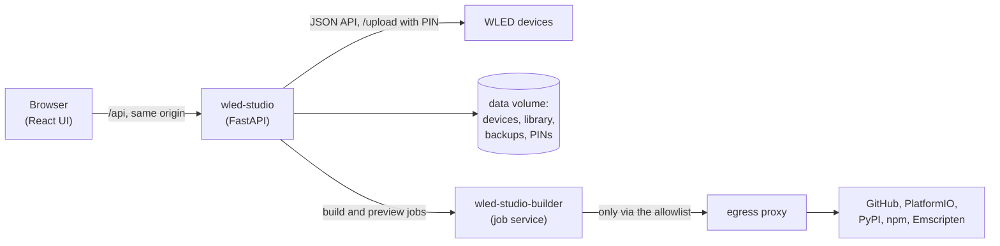

# Architecture

How the app is put together. For WLED's own building blocks (firmware, segments, layers, presets),
which the app edits, see [wled-model.md](wled-model.md).

- **One container** serves the built UI and the API. State lives in a data volume:
  - `devices.json` and `secrets/<id>.pin` (mode 0600);
  - `library.json` with its earlier versions in `history/` (`library-<n>.json`, the newest 500;
    listed and restored through `/api/library/versions`);
  - `deleted/`: the newest 50 deleted room models and slot grids, each with its original content
    and deletion time. They are listed through `/api/deleted` and restored through
    `/api/deleted/<id>/restore`; this is separate from library history and is not part of a studio
    file. A room restore refuses a missing device or an existing model unless `replace` is explicit.
    A grid restore keeps its assignments, chooses a non-colliding id, appends " (restored)" to a
    taken name, and refuses preset ids that overlap another grid;
  - `backups/<device>/` and `state/` (the last written presets hash per device). Each preset
    safety backup is `<stamp>-presets.json`; a device-settings backup is a
    `<stamp>-cfg/cfg.json` folder, while flash/revert folders also contain `cfg.json` alongside
    their other pre-write files;
  - `room-maps.json`: which device's room shape each effect folder's `room_map.h` was generated
    from, and a digest of that shape, so the studio can say when it's out of date (kept here, not
    in the effect folder, which may be a public repository);
  - `flashes/<device>/`: each flash and revert, with what the device ran before (`before`). Both
    swap WLED's two firmware slots, so the latest one that reached the device says what the other
    slot holds (`GET /api/devices/<id>/previous-firmware`; unknown before the app's first).
  - Removing a device (`DELETE /api/devices/<id>`) deletes its entry, PIN, set, room shape,
    `state/` files and `flashes/<device>/`, and ends its editing session; `backups/<device>/`
    stays. So a device added again under the same name (and so the same id) starts clean.
- **The library is the source of truth.** A device's `presets.json` is generated from it: looks are
  stored with effect and palette *names* and a snapshot of each effect's metadata, and resolved to
  the device's ids when written (see `backend/src/wledstudio/library.py` for the change-check
  statuses).
- **Custom palette files have per-device ownership.** WLED 16 stores them as
  `palette<i>.json`, with id `200 - i`; wled-studio keeps a per-device manifest of the names,
  indexes and content hashes it has saved. `/api/devices/<id>/palettes` reads both WLED stop
  encodings, normalizes them to the library format, and reports ownership and equal library matches.
  Importing copies selected stops into the library and claims their existing manifest indexes, so
  presets using those ids resolve to the new names. Push discovery reserves every occupied index
  absent from the manifest; replaced files are backed up and read back before presets are written.
  `cpalcount` is the size of WLED's custom-palette vector (including gray placeholders), so the
  backend probes only those indexes and ignores missing placeholder files.
- **A look can own the segment layout** (`clear_other_segments`): showing it deletes the device's
  other segments, as WLED's own presets saved with segment bounds do. They pad the segment list
  with `{"stop":0}` up to the device's limit (`info.leds.maxseg`), and so does the app. Captured
  looks own the layout. Imported ones keep what the device's preset did, so an import followed by a
  write leaves unchanged presets unchanged.
- **A look keeps every field WLED saves in a preset** (blending style, quick-load label, CCT,
  segment set, sound simulation, 1D→2D mapping, …), and an `id` only where the preset had one. So a
  preset saved in WLED's own UI, or written by a script, survives an import and a write byte for
  byte, apart from what was edited.
- **Segments can be named by wall or zone.** The room model has walls (its labelled edges) and
  zones (named LED ranges: a door, a desk). When a look is captured or imported, a segment that
  covers exactly one wall gets that wall's name (`wall`), or else one zone's name (`zone`). Showing
  or writing the look takes the LEDs from the room model at that time, so correcting a boundary
  there moves every look on that wall or zone, with a note in the write plan. A look on a wall or
  zone the model no longer has is unavailable. Without a room model the saved LEDs are used.
- **A look's preset id** can be changed after saving (`PUT /api/looks/<name>/preset-id`, or the
  look editor's save); it's a library change, written on the next write. The old preset stays on
  the device, since writing never deletes. An id another item has is accepted and named
  (`shared_with`), and the write refuses until one of them moves. The slot grid references saved
  looks/playlists: filling normally moves the item to that id; "also use here" stores the extra
  assignment in `slots.json`. That reference is expanded only in the push plan, with the grid's
  optional name pattern, so the library keeps one source item. **On the device every item on a
  slot's id carries the slot's name** (`device_name`, set by `slots.expand_for_push` for the write
  only): a moved look stays "Fire" in the library and is written as "B2·3 Fire", because whatever
  reads the device's preset names (a remote's bank labels in home automation) depends on it.
  The pattern must match the names already there: `base()` strips only a prefix made from it, so
  "B2·3 Fire" under a pattern "R{row}·{col} {name}" would be written "R2·3 B2·3 Fire". The grid
  view warns (`pattern_warning`, and a note on the cell) when a name starts like a slot name but
  not the grid's pattern.
- **A look saved without the layout** (`layout=false` on capture) keeps no bounds and doesn't own
  the layout: shown, it changes only the segments it names, by position.
- **Writing** replaces `presets.json` as a whole (`push.py`):
  0. refuse (409) when two looks, or a look and a playlist, want the same preset id: which one
     would end up on the device is left to chance. The dry run lists them as `duplicates`;
  1. back up the current file;
  2. check for drift since the last write;
  3. upload, with the PIN unlocked only for that and locked again in a finally path;
  4. read back and verify.

  Entries the library doesn't manage are kept as they are. The plan's rows say what the device
  holds at each id now (`on_device`: its name, or none) and whether writing changes it
  (`changed`); "review" looks are written when accepted, all at once or by name. The UI's write
  bar runs the dry run when a view opens and, debounced, after library changes (never on a timer),
  and shows when the app last wrote the device (`last_write`, kept with the hash in `state/`).
- **Device settings backups** read only `/cfg.json`, never WLED's secret `wsec.json`. The cfg
  backup list includes manual backups and flash/revert folders. A restore first compares every
  leaf path with the current file, identifies another device by matching WLED 16's `id.name` and
  `id.mdns` (and any MAC-like `id` field when present), and flags the `nw`, `ap`, `eth` and `wifi`
  sections. Both device identity and network changes need separate overrides. The restore then
  checks the inspected hash again, saves the current cfg in a new `<stamp>-cfg` folder, uploads the
  complete `cfg.json` with the settings PIN unlocked, waits for the device to reboot using the
  same bounded poll as flashing, and reads cfg back. Any boot normalization is reported as
  read-back differences; it is not treated as a failed upload.
- **The fake device** (`wledstudio.fakewled`) implements the API subset with made-up effects; it
  backs the tests and `docker compose --profile demo`. Its cfg.json upload reboots and returns the
  complete uploaded file unchanged, so the cfg restore tests found no normalization differences.
  Normalization by real devices has not been verified.
- **The virtual device** (`docker compose --profile virtual`) is wled-studio-builder's
  `virtual/`: WLED's own code compiled to WebAssembly behind WLED's API, a twin of a firmware. It
  reports `arch: "virtual"`, which the flash plan blocks.
- **The firmware side** is [wled-studio-builder](https://github.com/Laffs2k5/wled-studio-builder):
  verified reproducible builds of vendor WLED images, with your own effects added. The app will run
  it as a separate service for build jobs (no Docker socket in the app container).
- **A build target matches a device** (`frontend/src/targets.ts`) when the device's `release` or
  `product` in `/json/info` (QuinLED's builds say `Dig-Next-2`) is the target's environment
  (`dig-next-2`), ignoring case and punctuation, and the pins file's release (`quinled-16.0.1`)
  ends in the device's `ver`. There is no other mapping; a vendor whose names differ needs one there.
