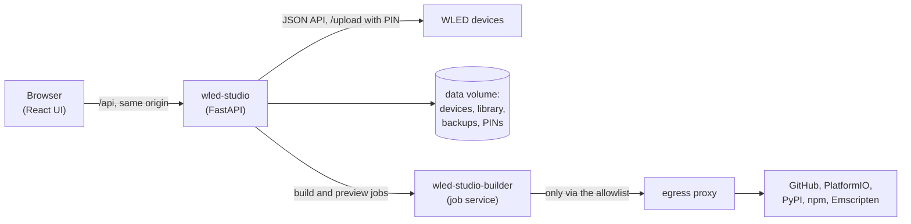

# Architecture

How the app is put together. For WLED's own building blocks (firmware, segments, layers, presets),
which the app edits, see [wled-model.md](wled-model.md).

- **One container** serves the built UI and the API. State lives in a data volume:
  - `devices.json` and `secrets/<id>.pin` (mode 0600);
  - `library.json` with every earlier version in `history/`;
  - `backups/<device>/` and `state/` (the last written presets hash per device);
  - `flashes/<device>/`: each flash and revert, with what the device ran before (`before`). Both
    swap WLED's two firmware slots, so the latest one that reached the device says what the other
    slot holds (`GET /api/devices/<id>/previous-firmware`; unknown before the app's first).
  - Removing a device (`DELETE /api/devices/<id>`) deletes its entry, PIN, set, room shape,
    `state/` files and `flashes/<device>/`, and ends its editing session; `backups/<device>/`
    stays. So a device added again under the same name (and so the same id) starts clean.
- **The library is the source of truth.** A device's `presets.json` is generated from it: looks are
  stored with effect and palette *names* and a snapshot of each effect's metadata, and resolved to
  the device's ids when written (see `backend/src/wledstudio/library.py` for the change-check
  statuses).
- **A look can own the segment layout** (`clear_other_segments`): showing it deletes the device's
  other segments, as WLED's own presets saved with segment bounds do. They pad the segment list
  with `{"stop":0}` up to the device's limit (`info.leds.maxseg`), and so does the app. Captured
  looks own the layout. Imported ones keep what the device's preset did, so an import followed by a
  write leaves unchanged presets unchanged.
- **A look keeps every field WLED saves in a preset** (blending style, quick-load label, CCT,
  segment set, sound simulation, 1D→2D mapping, …), and an `id` only where the preset had one. So a
  preset saved in WLED's own UI, or written by a script, survives an import and a write byte for
  byte, apart from what was edited.
- **Segments can be named by wall or zone.** The room model has walls (its labelled edges) and
  zones (named LED ranges: a door, a desk). When a look is captured or imported, a segment that
  covers exactly one wall gets that wall's name (`wall`), or else one zone's name (`zone`). Showing
  or writing the look takes the LEDs from the room model at that time, so correcting a boundary
  there moves every look on that wall or zone, with a note in the write plan. A look on a wall or
  zone the model no longer has is unavailable. Without a room model the saved LEDs are used.
- **A look's preset id** can be changed after saving (`PUT /api/looks/<name>/preset-id`, or the
  look editor's save); it's a library change, written on the next write. The old preset stays on
  the device, since writing never deletes. An id another item has is accepted and named
  (`shared_with`), and the write refuses until one of them moves. The slot grid shows whatever
  has its ids, so a look moved onto a slot's id appears there under its own name.
- **A look saved without the layout** (`layout=false` on capture) keeps no bounds and doesn't own
  the layout: shown, it changes only the segments it names, by position.
- **Writing** replaces `presets.json` as a whole (`push.py`):
  0. refuse (409) when two looks, or a look and a playlist, want the same preset id: which one
     would end up on the device is left to chance. The dry run lists them as `duplicates`;
  1. back up the current file;
  2. check for drift since the last write;
  3. upload, with the PIN unlocked only for that and locked again in a finally path;
  4. read back and verify.

  Entries the library doesn't manage are kept as they are. The plan's rows say what the device
  holds at each id now (`on_device`: its name, or none) and whether writing changes it
  (`changed`); "review" looks are written when accepted, all at once or by name. The UI's write
  bar runs the dry run when a view opens and, debounced, after library changes (never on a timer),
  and shows when the app last wrote the device (`last_write`, kept with the hash in `state/`).
- **The fake device** (`wledstudio.fakewled`) implements the API subset with made-up effects; it
  backs the tests and `docker compose --profile demo`.
- **The virtual device** (`docker compose --profile virtual`) is wled-studio-builder's
  `virtual/`: WLED's own code compiled to WebAssembly behind WLED's API, a twin of a firmware. It
  reports `arch: "virtual"`, which the flash plan blocks.
- **The firmware side** is [wled-studio-builder](https://github.com/Laffs2k5/wled-studio-builder):
  verified reproducible builds of vendor WLED images, with your own effects added. The app will run
  it as a separate service for build jobs (no Docker socket in the app container).
- **A build target matches a device** (`frontend/src/targets.ts`) when the device's `release` or
  `product` in `/json/info` (QuinLED's builds say `Dig-Next-2`) is the target's environment
  (`dig-next-2`), ignoring case and punctuation, and the pins file's release (`quinled-16.0.1`)
  ends in the device's `ver`. There is no other mapping; a vendor whose names differ needs one there.
