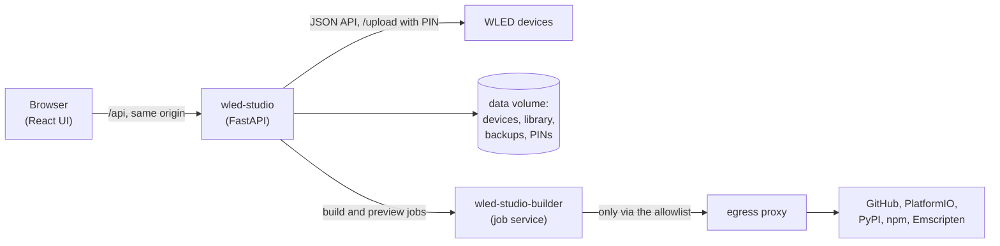

# Architecture

- **One container** serves the built UI and the API. State lives in a data volume:
  - `devices.json` and `secrets/<id>.pin` (mode 0600);
  - `library.json` with every earlier version in `history/`;
  - `backups/<device>/` and `state/` (the last written presets hash per device).
- **The library is the source of truth.** A device's `presets.json` is generated from it: looks are
  stored with effect and palette *names* and a snapshot of each effect's metadata, and resolved to
  the device's ids when written (see `backend/src/wledstudio/library.py` for the change-check
  statuses).
- **Writing** replaces `presets.json` as a whole (`push.py`):
  1. back up the current file;
  2. check for drift since the last write;
  3. upload, with the PIN unlocked only for that and locked again in a finally path;
  4. read back and verify.

  Entries the library doesn't manage are kept as they are.
- **The fake device** (`wledstudio.fakewled`) implements the API subset with made-up effects; it
  backs the tests and `docker compose --profile demo`.
- **The firmware side** is [wled-studio-builder](https://github.com/Laffs2k5/wled-studio-builder):
  verified reproducible builds of vendor WLED images, with your own effects added. The app will run
  it as a separate service for build jobs (no Docker socket in the app container).
