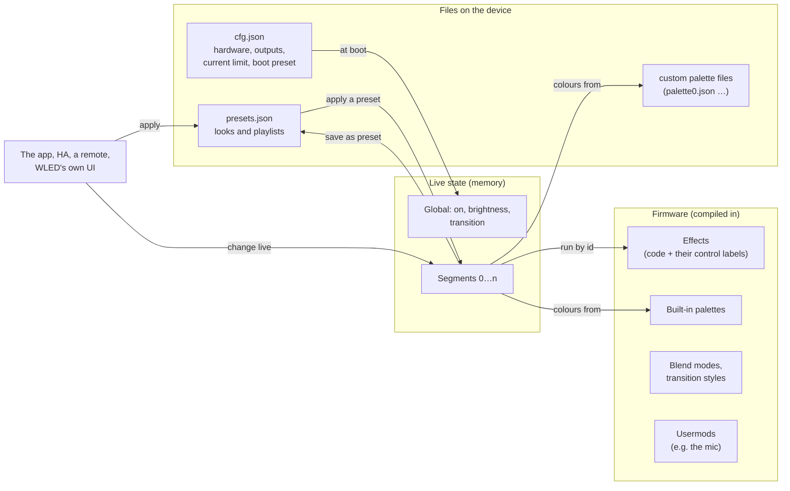
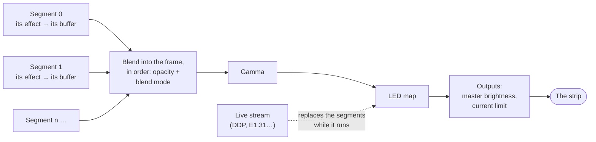
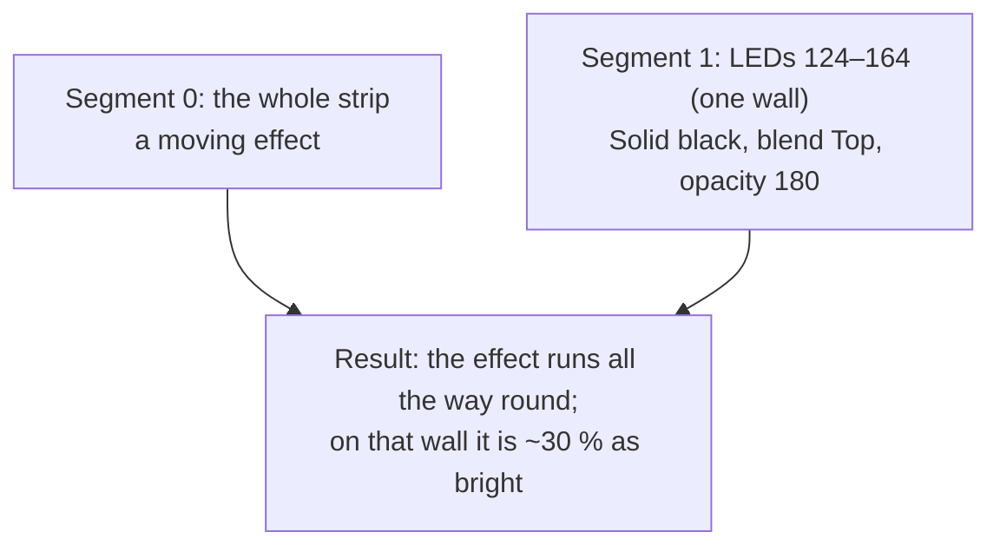
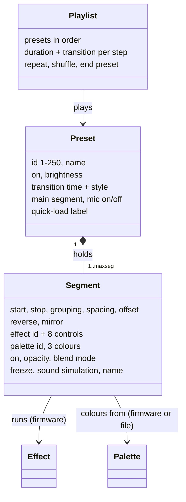
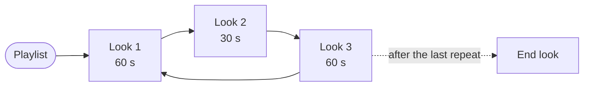
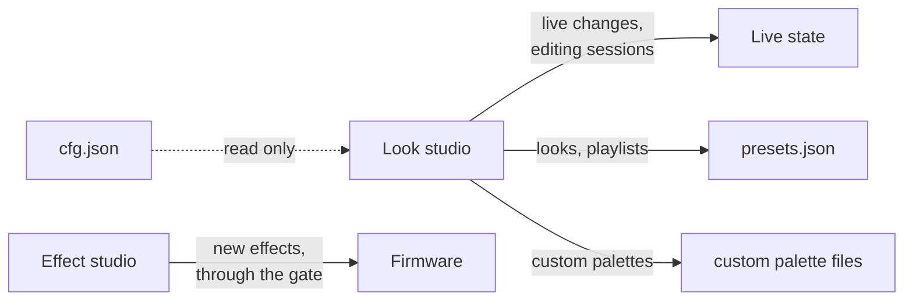

# How WLED works: the building blocks

What WLED is made of, where each part lives, and how a picture on the strip comes about. Everything
wled-studio does sits on top of this. Facts are from WLED 16.0.1's source (file names in brackets).

## The short version

- **Firmware** holds the *kinds* of things: the effects (animations, as compiled code), the built-in
  palettes, the blend modes, the transition styles. New kinds need new firmware.
- **Files on the device** hold the setup and the saved looks: the hardware config (`cfg.json`),
  the presets and playlists (`presets.json`), custom palettes (`palette<i>.json`).
- **The live state** (in memory) is what shows now. It is a list of **segments**: each one a range of
  LEDs running one effect, with its own settings.
- **A look is a preset:** a saved live state, with its segment layout. A **playlist** is a preset that
  plays other presets in turn.
- **Segments need no firmware.** Making, moving, layering and saving them is all state and presets.

## Where things live

| Thing | Lives in | Changing it takes |
|---|---|---|
| Effects: their code, and which controls they use under which labels | firmware | a new build and a flash |
| Built-in palettes, blend modes, transition styles | firmware | a new build |
| Usermods (the mic, relays, …) | firmware for the code, `cfg.json` for their settings | a build for the code; a config upload for the settings |
| The hardware: outputs, LED count and type, current limit, Wi-Fi, the boot preset | `cfg.json` | a config upload (it reboots the device) |
| Custom palettes | `palette<i>.json` | a file upload |
| Looks (presets) and playlists, **with their segment layouts** | `presets.json` | a file upload |
| What shows now, segments included | memory | the JSON API (`/json/state`); lost at a reboot unless saved |

WLED has no scripting at runtime: a new *kind* of animation is new firmware. New *arrangements* of
the existing ones never are.

## Segments

A segment is a **range of LEDs running one effect**, with its own settings. It is part of the live
state, and it is saved inside presets.

What one segment holds (the fields WLED saves for it in a preset, `json.cpp` `serializeSegment`):

| Group | Fields |
|---|---|
| **Where** | start and stop LED (stop is the first LED *after* it); grouping (LEDs sharing one pixel); spacing (dark LEDs between groups); offset (shifts the pattern); reverse; mirror |
| **What runs** | the effect (by id), and its up to eight controls: speed, intensity, three custom sliders, three checkboxes. Each effect uses its own subset, under its own labels (Comet's intensity is "Tail") |
| **Colours** | a palette (by id), and three colour slots (Fx, Bg, a third), each red, green, blue and white |
| **How it shows** | on or off; its own brightness, which is its opacity when layered; the blend mode; freeze; sound simulation (a stand-in beat for sound effects while the mic is off) |
| **Housekeeping** | a name, a set (a UI group), selected |

What belongs to the whole state, not to one segment: on/off, the master brightness, the transition
time and style, the mic (on or off), and which segment is the main one.

Rules that matter:
- **A segment is one unbroken range.** "Everything but one wall" in the middle of the strip is two
  segments, or one whole-strip segment with a layer over that wall.
- **Segments may overlap.** They are drawn in order, 0 first, so a later one is a **layer** over the
  earlier ones (next section).
- **Each segment runs its own copy of its effect,** with its own memory. Two segments with the same
  random effect look different. Two with a deterministic one on the same input (a sound meter on one
  mic) stay in step.
- **One clock for all:** every segment renders on the same frame, against the same time base
  (`FX_fcn.cpp` `service`).
- **How many:** up to `info.leds.maxseg` (32 or 64, depending on the build and the board's memory).
  New segments are appended to WLED's list; a deleted one stays as an inactive slot until WLED
  tidies up.
- **LEDs in no segment are dark.**

## How a frame is made

1. Each active segment runs its effect into **its own pixel buffer** (`service`). During a
   transition the old effect runs too, and the two are mixed in the transition's style.
2. The frame is **cleared**, and the segments are **blended into it in order** (`show`,
   `blendSegment`): each pixel becomes *below* blended towards *blend mode(segment, below)* by the
   segment's opacity. The default mode, Top, just covers what is below.
3. **Gamma**, the LED map, then the outputs, which apply the master brightness and the current limit.

A live stream (DDP, as wled-studio's "stream to the strip") paints the pixels itself while it runs,
and the segments aren't drawn.

### Layers, by example

The 17 blend modes (`FX_fcn.cpp`, `BLENDMODES`): Top, Bottom, Add, Subtract, Difference, Average,
Multiply, Divide, Lighten, Darken, Screen, Overlay, Hard light, Soft light, Dodge, Burn, Stencil.
Some uses:
- **Top** at part opacity: dims what is below (a black layer) or mixes in a colour;
- **Multiply:** tints what is below, or masks it (white shows it, black hides it);
- **Screen, Lighten, Add:** bright things on top (flashes, sparks) without darkening the rest.

## Looks: presets

A preset is a **saved state**: the global settings and the segments, stored under an id (1–250) and
a name in `presets.json`. Applying one is the same as sending its JSON to the live API
(`presets.cpp`).

- **With or without the layout.** A preset saved *with segment bounds* owns the layout: WLED pads its
  segment list with `{"stop":0}` up to the segment limit, so applying it deletes the segments it
  doesn't use. A preset *without* bounds changes only the segments it names, and leaves the layout
  as it is.
- **Transitions:** when a preset (or any change) switches effects or colours, WLED moves from the old
  picture to the new over the transition time, in one of eight styles for a strip: Fade, Fairy Dust,
  Swipe right/left, Push right/left, Outside-in, Inside-out.
- **At boot** the device applies its boot preset (`cfg.json`), or else makes default segments: one
  over everything, or one per output.

## Playlists

A playlist is a preset whose content is a list of other presets, each with a duration and a
transition, and with repeat, shuffle and an end preset (`playlist.cpp`). The device runs it on its
own, with no app or HA needed.

## Static and dynamic

**Within one look, the segments are fixed.** Their bounds, opacity and blend modes don't move by
themselves. What moves is what runs *inside* them. Ways to get change over time:

| Want | Way | Note |
|---|---|---|
| Motion inside an area | the effect itself | most effects animate; speed and the other controls shape it |
| Reacting to sound | a sound-reactive effect (the mic usermod) | many draw only part of their segment, e.g. a growing bar |
| Something appearing over a steady base | a layer with an effect that is mostly dark (sparks, flashes), on Screen, Lighten or Add | the base runs on underneath |
| The layout changing every so often | **a playlist** of looks, each with its own layout | steps of seconds, not smooth movement; effects and colours change in the transition style |
| Changes on events (a door, an alarm, a cue) | live changes from outside: HA, a script, the app, through the JSON API | e.g. a temporary segment added and removed again; requests, not animation |
| Areas that truly move, grow or spread (a flash spreading from a point, a zone sweeping round the room) | **an own effect**, which decides per LED and per frame | needs firmware; room-aware effects can use each LED's position |

So a playlist can fake a changing layout in steps. A layout that moves smoothly is an effect's job.

## What wled-studio edits

- **The look studio** edits segments live, and keeps looks in its library by name: effects and
  palettes by name, not id, with each effect's metadata as it was when saved (the change check). It
  writes `presets.json` and the custom palettes. A look it captures owns its layout.
- **The effect studio** is the only part that makes firmware: an own effect is compiled into a vendor
  build, checked by the gate, and flashed.
- **`cfg.json`** (the hardware) is not edited.
